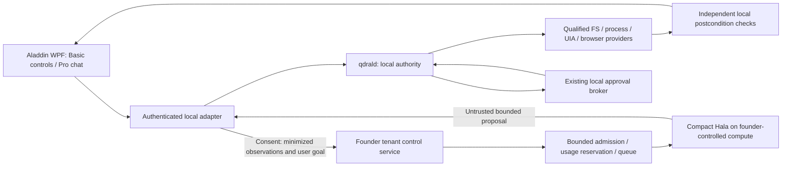

# Native Hala architecture, security and privacy

Status: PROPOSED research supplement to [adopted architecture](ARCHITECTURE.md)
and [existing model contracts](MODEL_INTEGRATION_CONTRACTS.md). No runtime authority
or remote protocol changes are implemented by this package.

## Selected architecture

Use one compact founder-hosted multimodal model and a tool-first harness. Keep
WPF, the Node MCP edge, existing providers, the Go Computer Host and `qdrald`.
Basic uses local command forms and deterministic recipes. Pro adds native text
chat and founder-side planning; it needs neither a customer GPU nor external AI
keys. Hala is an internal engine of Aladdin, never a prerequisite separate app.



The arrows into the authority kernel remain the existing constrained execution
boundary. The new local/cloud adapter is proposed; it must be separately
qualified. A hosted origin must not gain the local-only `desktop_structured`
profile by routing through a UI client. Pro requires an explicitly governed,
device-bound proposal contract/local integration before desktop actions are
reachable. The currently remote-capable `core` tools are useful for a filesystem
pilot but do not authorize remote Full User desktop or browser control.

## What intelligence owns, and what it cannot own

The founder service owns conversation understanding, planning, optional recovery,
model selection and inference queues. Local execution owns permissions, approval,
exact target identity, observation freshness, workspace, method ceiling, dispatch,
interruption, revocation and final-state verification. Deterministic local
recipe expansion and safety checks are execution, not local model inference.

No model field can grant approval, choose a higher privilege, modify policy,
declare a task verified or forge a receipt. The existing local broker presents
each consequential exact operation; a task-level plan is not a blanket approval.
Approval fatigue is a real UX cost. A future bounded transaction approval would
need its own authority review; do not quietly batch existing approvals away.
Preserve SOFT mutations and STRONG removal/trust/Full User grants as applicable.

## Minimal task loop

1. Bind an intent to principal, device and workspace; discover only qualified
   capabilities and explain unavailable ones. Allocate a task id and budget.
2. A Basic recipe selector or exact saved workflow chooses a deterministic
   template. A Pro free-text request goes to Hala unless the user selected a
   previously confirmed template. Do not pretend regex parsing understands all
   natural language. Ambiguous date semantics ask-user before mutation.
3. Hala returns a finite template/goal proposal, not arbitrary shell or program
   code. The first file task returns `organize_files`, extension grouping, date
   field and approved destination class; local code expands the inventory.
4. Validate against the existing tool contract, device-minted identities and
   policy. Display bounded intent and exact action previews. Reject unknown
   fields, fake refs, stale observations, byte excess and higher method claims.
5. Execute qualified operations with their existing fresh approvals. Recheck
   generations/identities at dispatch. Emit real kernel events and receipts.
6. Verify independent filesystem/browser/UI postconditions. Continue deterministic
   steps without another model call when the authorized recipe remains valid.
7. On unexpected structured state, reobserve once; call Hala only for new
   ambiguity, up to task ceilings. On unknown mutation, reconcile; never replay
   because the model says an operation failed. Report verified/partial/denied/
   interrupted/unknown separately. Cloud outage stops new planning, not local stop.

## Proposed contract amendment

Reuse the model-id/revision/prompt/config provenance and device observation
bindings in `MODEL_INTEGRATION_CONTRACTS.md`. The earliest filesystem intent
schema should be a narrow discriminator rather than adding unrestricted tools
to `ComputerActionProposal`. A candidate, not an exported API:

```json
{
  "schema": "aladdin.file_intent.v1",
  "task_id": "opaque",
  "request_id": "opaque",
  "observation_generation": "device-minted",
  "template": "organize_files",
  "group_by": "extension_then_year_month",
  "date_field": "modified_utc",
  "collision": "stop_and_report",
  "status": "propose"
}
```

The actual adapter binds authenticated principal/session/device/epoch, expiry,
workspace and inventory hash outside model-controlled fields. Root/path strings
must come from the trusted selection, not the proposal. Local expansion uses
workspace-relative operations and already authorized FS identity checks.
Filesystem metadata beyond current `fs_list` output is a missing observation
contract, not permission to inspect arbitrary paths. Schema changes and the new
adapter require a new approved packet; no field above is a production feature.
Keep `qdral-relay/1` frame vocabulary frozen. HTTPS control traffic is not a
new relay frame; any envelope carrying proposals needs its own reviewed binding.

## Inference minimization, with limits

| Mechanism | Practical rule | Evidence to collect |
|---|---|---|
| Tool discovery/routing | Qualified native function first; DOM/AX before UIA before vision only within the already authorized method ceiling | Calls/actions eliminated; false template routes |
| Bounded plans | Expand exact known FS/report recipes locally; wait on events and verify with checkers | Zero/one/few/repeated-call task ablation |
| Observation minimization | Send relevant names/roles, truncation markers and one consented crop only when needed | Accuracy vs bytes/image tokens at 768/1024/1280 long edge |
| Short output | Narrow JSON, 256 output tokens, bounded reasoning; no prose history replay | Parse failures, latency, total billable seconds |
| Prefix caching | Stable prompts and pinned capability description; account/session partition | Real cache hit and billed-work reduction; cache isolation |
| Output caching | Only unchanged read-only planning state at same goal/model/prompt/device generation; short TTL | Reject stale cache; never cache approvals, secrets or success proofs |
| Quantization | Paired BF16 vs supported 8/4-bit comparison; preserve processor identity | Wrong-target/abstention/Arabic deltas and resident VRAM |
| Batching | Microbatch independent tenants only with proven isolation and bounded scheduling | Batch 1/2/4, KV/image memory, p95/p99; don't batch a task's dependent actions |
| Async execution | GPU released between user approvals/tool waits unless measured reuse saves money | Startup/idle vs keepalive and whole-task latency |
| Recovery | Deterministic retry only when definitely undispatched and safely idempotent | Unknown-outcome count, duplicate-effect count, model repair calls |
| Escalation | Initially off; one separately capped larger-model retry only after paired benefit | Incremental verified completions per incremental dollar |

For the file organizer, GUI clicks, screenshot interpretation and model-based
success judgments are unnecessary. `fs_list`, `fs_find`, `fs_read_range`,
`fs_mkdir`, `fs_move`, content hashes and postcondition checks carry the work.
UIA element refs replace click coordinates where qualified. Later native web
extraction/map/crawl and validated WebMCP discovery can replace visual reading
and repeated navigation, but current helper existence is not release reachability.

## Privacy and failure boundaries before Pro launch

TLS in transit; encrypted provider disks/backups plus access-controlled secrets.
Founder control of deployment does not remove the cloud operator from the
processor threat model. Require DPA/region/deletion/logging review, credential
rotation and infrastructure patching; don't imply endpoint E2E against inference
servers, which need plaintext to process observations.

Default no raw screenshot/prompt persistence and no training on customer data.
Separate explicit diagnostic opt-in from service consent and from any future
training consent. Keep local bounded task history; server metering logs use
opaque ids, timing/size/counts and typed errors with a proposed 30-day retention
maximum. This retention choice requires adoption and legal review; existing
privacy terms currently describe self-hosted connectivity and must be amended
before founder-hosted Pro is released. No legal policy is overwritten here.

Password/protected windows, credentials, UAC and security surfaces stay excluded.
Crop/redact locally before egress; if sensitivity cannot be bounded, ask-user
or deny screen upload. Registered-secret filtering cannot find every unknown
secret. Do not promise zero leakage or screenshot-free Pro for visual tasks.
Minimize filenames as well as pixels; document that Pro transmits selected
information to the founder service and optional infrastructure processors.

Webpage/Markdown/DOM/tool output is untrusted data, never user intent. Bind
task instructions separately, label observations, refuse page-requested tool
or permission additions, and test injection with fake approvals and exfiltration
canaries. Tenant-separated queues, caches, task ids, object permissions and
usage ledgers prevent cross-user state reuse; delete KV caches after session expiry.
Short-lived access tokens and device proof prevent the AI service impersonating
a different target. Pairing/AI entitlement grants no workspace trust or lease.

Budget timeout, model/server outage and disconnect close proposal admission.
Local stop works independently of cloud/WPF health, releases input, interrupts
owned workers and reports unconfirmed termination honestly. Emergency revoke
retains its existing protected persistence flow. Resume reobserves and asks for
fresh approvals; it cannot restore old leases or auto-retry uncertain mutations.
Same-user malware, valid approval-ledger tail rollback and compromised
full-user workers remain existing residual risks; this architecture does not
claim to eliminate them.
